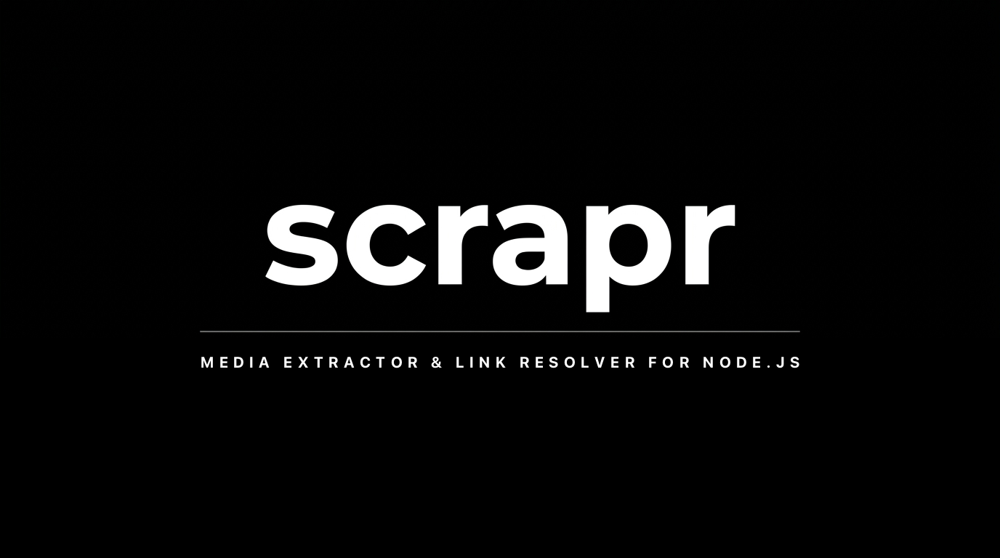

<div align="center">



# 🚀 apidownloader

**Universal Media Downloader Library for Node.js.**
_Pass a URL → get direct download links. 18 platforms, 40+ methods, built-in fallback chains._


`TikTok` • `Instagram` • `YouTube` • `Spotify` • `Twitter / X` • `Facebook` • `SoundCloud` • `Pinterest` • `Apple Music` • `Bilibili` • `Douyin` • `Bandcamp` • `Threads` • `Pixiv` • `RedNote` • `Reddit` • `TeraBox` • `MediaFire` • `Sfile` • `Safelinku` • `Sub2Unlock` • `Rekonise` • `Pixeldrain` • `Catbox` • `Google Drive` • `Krakenfiles` • `Doodstream` • `Unshorten`

</div>

---

## 📦 Installation

```bash
npm install git+https://github.com/nexusdevbot/apidownloader.git
```

Or clone manually:

```bash
git clone https://github.com/nexusdevbot/apidownloader.git
cd apidownloader
npm install
```

> **Requirements:** Node.js ≥ 16. No browser / headless Chrome needed — pure HTTP (axios + cheerio), cepat & ringan.

---

## 🚀 Quick Start

```javascript
const { tiktok, youtube, spotify } = require("apidownloader");

(async () => {
  // TikTok — auto multi-provider
  const tt = await tiktok.snaptik("https://www.tiktok.com/@user/video/123456");
  if (tt.status) {
    console.log("Title:", tt.result.title);
    console.log("Download:", tt.result.downloads[0].url);
  }

  // YouTube → MP3
  const yt = await youtube.ytmp3("https://www.youtube.com/watch?v=dQw4w9WgXcQ");
  if (yt.status) console.log("MP3:", yt.result.downloads[0].url);

  // Spotify — track & playlist
  const sp = await spotify.spotmate("https://open.spotify.com/track/xxxx");
  if (sp.status) console.log("Audio:", sp.result.downloads[0].url);
})();
```

---

## 📖 Usage — All Platforms

### 🎵 Media Platforms

| Platform | Methods | Example URL |
|----------|---------|-------------|
| `tiktok` | `snaptik` `tiktokio` `savetik` `ssstik` `tikdownloader` | `tiktok.com/@u/video/123` |
| `youtube` | `ytmp3` `ytmp3gg` `playlist` | `youtube.com/watch?v=...` |
| `instagram` | `indown` `snapinsta` `snapsave` `direct` | `instagram.com/p/xxx` |
| `spotify` | `spotmate` `spotidown` `soundloaders` `spotisaver` | `open.spotify.com/track/...` |
| `twitter` | `tweeload` `tvd` `savetwt` `direct` | `x.com/u/status/123` |
| `facebook` | `snapsave` `fdown` | `facebook.com/watch?v=...` |
| `soundcloud` | `klickaud` | `soundcloud.com/artist/track` |
| `pinterest` | `pindown` `direct` | `pin.it/xxx` |
| `applemusic` | `aplmate` | `music.apple.com/...` |
| `bilibili` | `direct` | `bilibili.tv/...` |
| `douyin` | `direct` | `douyin.com/video/...` |
| `bandcamp` | `direct` `bandcampdownloader` | `artist.bandcamp.com/track/x` |
| `threads` | `threadster` | `threads.net/@u/post/...` |
| `pixiv` | `ajax` | `pixiv.net/artworks/123` |
| `rednote` | `direct` | `xiaohongshu.com/...` |
| `reddit` | `rapidsave` | `reddit.com/r/.../comments/...` |
| `terabox` | `sechno` | `terabox.com/s/...` |

### 🔗 Link Resolver

```javascript
const { resolver } = require("apidownloader");

(async () => {
  // Direct file hosts → direct download URL
  const mf = await resolver.mediafire("https://www.mediafire.com/file/xxx/file.zip");
  console.log(mf.result.url);

  const pd = await resolver.pixeldrain("https://pixeldrain.com/d/xxxx");
  const cb = await resolver.catbox("https://files.catbox.moe/xxxx.png");
  const gd = await resolver.gdrive("https://drive.google.com/file/d/xxxx/view");
  const sf = await resolver.sfile("https://sfile.mobi/xxxx");
  const kf = await resolver.krakenfiles("https://krakenfiles.com/view/xxx");
  const dd = await resolver.doodstream("https://dood.ink/d/xxxx");

  // Social-unlock & shortlink resolvers
  const s2u = await resolver.sub2unlock("https://sub2unlock.io/xxx");
  const rek = await resolver.rekonise("https://rekonise.com/xxx");
  const sfl = await resolver.safelinku("https://sfl.gl/xxxx");

  // Generic unshortener
  const raw = await resolver.unshorten("https://aka.ms/vscode");
  console.log(raw.result.url);
})();
```

| Method | Purpose |
|--------|---------|
| `mediafire` `pixeldrain` `catbox` `gdrive` `krakenfiles` `doodstream` `sfile` | Bypass halaman download → direct URL |
| `sub2unlock` `rekonise` | Unlock social gateway → link tujuan |
| `safelinku` | Bypass shortlink berbayar → file asli |
| `unshorten` | Expand URL pendek apa pun (bit.ly, aka.ms, dst) |

### 🛡️ Fallback Chain (anti mati)

Setiap platform punya beberapa provider — kalau satu mati, tinggal fallback:

```javascript
const { tiktok } = require("apidownloader");

async function resolveTikTok(url) {
  const chain = [tiktok.snaptik, tiktok.ssstik, tiktok.savetik, tiktok.tiktokio];
  for (const scrape of chain) {
    try {
      const res = await scrape(url);
      if (res.status) return res.result;
    } catch (_) { /* next provider */ }
  }
  throw new Error("All providers failed");
}
```

> 💡 Semua scraper paralel-safe — bisa dipanggil dari `Promise.all()` untuk batch download.

---

## 📋 Response Schema

```json
{
  "status": true,
  "result": {
    "title": "Video Title",
    "thumbnail": "https://cdn.../cover.jpg",
    "type": "video",
    "downloads": [
      { "url": "https://cdn.../file.mp4", "type": "video", "quality": "720p" }
    ]
  }
}
```

- `status: false` → provider gagal / URL invalid → coba method lain (fallback)
- `downloads[]` → array, bisa berisi video **dan** audio (watermark / no-watermark)

---

## 💡 Tips & Best Practices

1. **Selalu cek `res.status`** sebelum akses `res.result`.
2. **Gunakan fallback chain** untuk platform produksi (provider bisa berubah sewaktu-waktu).
3. **Rate-limit yourself** — tambah delay antar request massal biar tidak diblok provider.
4. **URL pendek didukung** — `vt.tiktok.com`, `vm.tiktok.com`, `pin.it`, dll langsung valid.
5. **Batch** — pakai `Promise.allSettled()` untuk parallel banyak URL.

---

## 📝 Notes

- **Original engine by [coflyn/scrapr](https://github.com/coflyn/scrapr)** — forked & published here as `apidownloader`. Credit ke author asli 💙
- License: [MIT](LICENSE) — bebas dipakai untuk komersial & personal.
- Gunakan dengan bijak. Bukan untuk aktivitas yang melanggar ToS platform terkait.

<div align="center">

**⭐ Star repo ini kalau membantu!**

[](https://t.me/nexusweb_dev)

</div>
